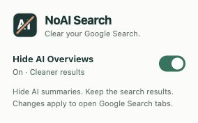

# NoAI Search — Google AI Overview Blocker for Chrome

**Clear your Google Search.** NoAI Search is a lightweight **Google AI Overview blocker for Chrome**. Hide AI Overviews with one toggle and keep regular search results in the All tab.

Want to **turn off AI Overviews in Google Search**? This extension hides the AI-generated summary locally in your browser. Switch it off whenever you want to see the original results again.

[Download ZIP](https://github.com/iridescent995/no-ai-search/archive/refs/heads/main.zip) · [Installation](#how-to-hide-google-ai-overviews-in-chrome) · [FAQ](#frequently-asked-questions) · [Report an issue](https://github.com/iridescent995/no-ai-search/issues)

  

## Features

- **One-click toggle:** a compact popup enables or pauses AI Overview hiding.
- **Live updates:** the setting applies to supported, already-open search tabs without a refresh after initial installation.
- **Saved preference:** your on/off choice stays on this Chrome profile across restarts.
- **Dynamic content:** handles AI Overviews inserted after the results load.
- **Regular results stay:** keeps the All tab, web links, and ordinary result sections.
- **Local processing:** no analytics, accounts, external requests, or collected search history.
- **Small footprint:** plain JavaScript and CSS, with no framework or build step.

## How to hide Google AI Overviews in Chrome

1. [Download NoAI Search as a ZIP](https://github.com/iridescent995/no-ai-search/archive/refs/heads/main.zip), or clone this repository: `git clone https://github.com/iridescent995/no-ai-search.git`.
2. Extract the ZIP into a permanent folder.
3. Open `chrome://extensions` in Chrome.
4. Enable **Developer mode**.
5. Choose **Load unpacked** and select the folder containing `manifest.json`.
6. Refresh Google Search tabs that were already open.
7. Pin **NoAI Search** using Chrome’s Extensions menu, then click its icon to toggle **Hide AI Overviews**.

Chrome 105 or later is required. This is a locally installed extension; no Chrome Web Store listing is currently provided.

### Updating an existing installation

Download the latest files or run `git pull` in your clone. Keep them in the same extension folder, click **Reload** on the NoAI Search card at `chrome://extensions`, then refresh your Google Search tabs.

## One-click AI Overview toggle

The popup is 284 × 176 pixels. Its only setting controls AI Overview hiding across supported Google Search tabs.

## How it works

A Manifest V3 content script runs only on the Google Search URL patterns listed in `manifest.json`. CSS targets known AI Overview containers. An exact-heading fallback handles additional English layouts, and a mutation observer handles newly loaded content. The popup stores a single `enabled` boolean using `chrome.storage.local`; open search tabs listen for setting changes.

Structural selectors work independently of interface language. The exact-heading fallback currently supports English. Google may change its markup, so future selector updates may be necessary. There may be a brief display of the overview while the saved setting loads.

## Supported Google Search domains

`www.google.com`, `www.google.co.in`, `www.google.co.uk`, `www.google.ca`, `www.google.com.au`, `www.google.de`, `www.google.fr`, `www.google.es`, `www.google.it`, `www.google.co.jp`, and `www.google.com.br`.

For another Google domain, add its exact `https://www.google.example/search*` match pattern to `manifest.json`, reload the extension, and refresh the results page. Replace the example with the actual Google host.

## Privacy and permissions

| Access | Purpose |
| --- | --- |
| `storage` | Save the on/off preference locally in this Chrome profile. |
| Listed Google Search pages | Find and hide AI Overview elements. |

No search queries, result contents, browsing history, or personal information are stored or transmitted by the extension. There is no backend, telemetry, remote code, or runtime dependency. README badges request images from Shields.io when viewed on GitHub; the extension itself does not contact it.

## Frequently asked questions

### How do I disable AI Overviews in Google Search?

Install NoAI Search, refresh Google Search, and leave **Hide AI Overviews** enabled in the popup. The extension hides supported AI Overview sections while preserving normal web results.

### Does this turn off Google AI Overviews permanently?

It hides AI Overviews locally on supported search pages while enabled. It does not change Google’s account settings or stop Google from generating answers.

### Does it remove AI Mode?

No. The separate AI Mode tab remains available. This extension targets AI Overviews in standard search results.

### Does it redirect me to Google’s Web filter?

No. It leaves the current search URL and the All tab in place.

### Can I turn AI Overviews back on?

Yes. Open the popup and switch **Hide AI Overviews** off. Supported open tabs restore the hidden sections immediately.

### Why is an AI Overview still visible?

Refresh the page after first installing or reloading the extension, confirm the toggle is on, and check that the host is listed above. If Google has changed its layout, report the interface language, Google host, Chrome version, and a sanitized screenshot. Avoid including private searches or account details.

## Development

No build step is required. Edit the source, reload the unpacked extension, then refresh its search tabs. Run popup preference and error-handling tests with `node --test tests/popup.test.cjs` (Node.js required only for these tests). See [CONTRIBUTING.md](CONTRIBUTING.md) for regression checks.

| File | Purpose |
| --- | --- |
| `manifest.json` | Extension name, site scope, popup, icons, and permissions |
| `hide-overview.css` | Setting-gated AI Overview selectors |
| `hide-overview.js` | Saved preference, live changes, and layout fallback |
| `popup.html`, `popup.css`, `popup.js` | Compact, keyboard-accessible toggle |
| `icons/` | PNG icons in 16, 32, 48, and 128 px; editable SVG master |

Independent project; not affiliated with Google. Google and Chrome are trademarks of their respective owners.
